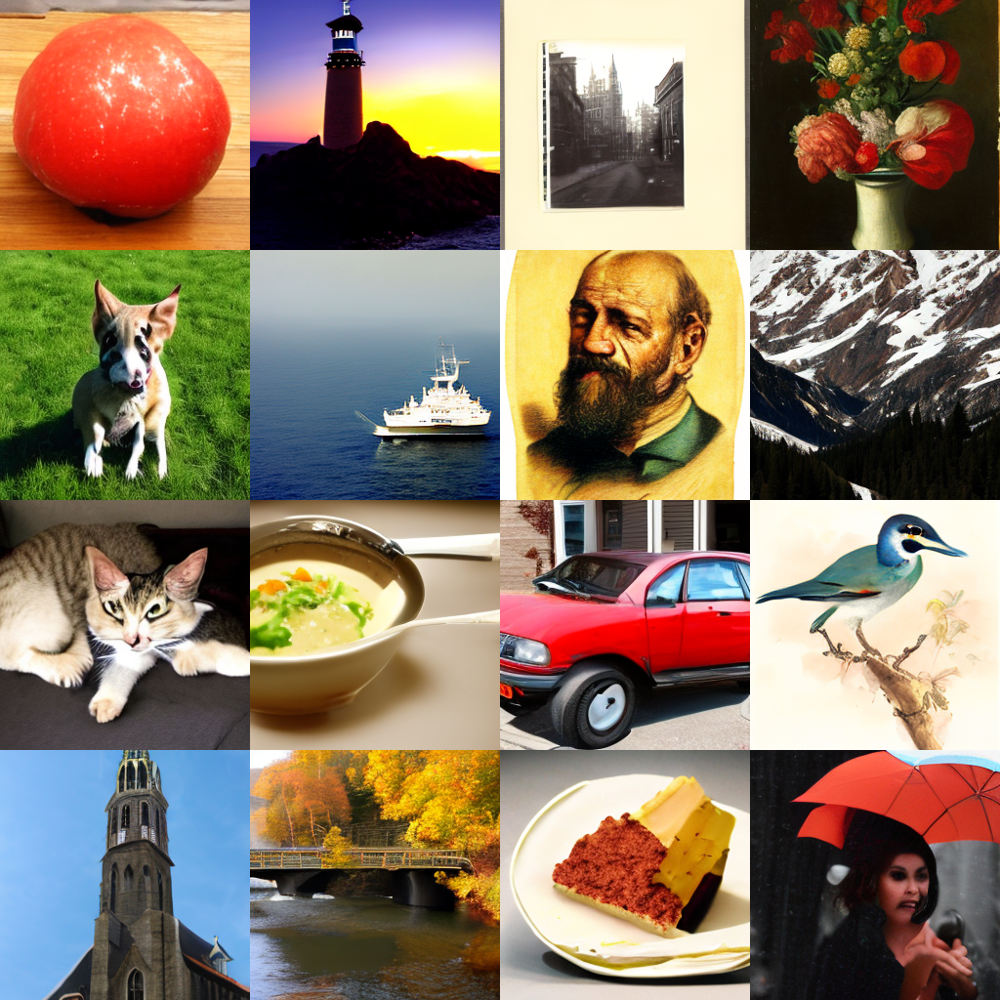

<p align="left"><strong>UDGAM LABS</strong> · A small text-to-image model</p>

# Chitra Tiny

A 212M-parameter English **text-to-image** model that makes 256×256 pictures from a sentence. Built by **Udgam Labs**, a frontier technology lab in India. The image model was trained from scratch, on about 4.7 million public-domain and CC0 images. It runs on a laptop: about 3 seconds per image on an Apple-silicon Mac. *Chitra* (चित्र) means "picture".

**Public release, 12 October 2026:** weights and model card on [Hugging Face](https://huggingface.co/UdgamLabs/Chitra-Tiny), a [visual walkthrough](https://udgamlabs.github.io/chitra-tiny/), and code, examples and checksums in this repository. Apache-2.0.

<p align="center"></p>

<sub>One image per prompt, seeds 0–15, guidance 7, 50 steps. The prompts are listed in the <a href="https://huggingface.co/UdgamLabs/Chitra-Tiny">model card</a>.</sub>

[Get started](#get-started) · [Examples](#runnable-examples) · [How it works](#how-it-works) · [How good is it](#how-good-is-it) · [Limits](#know-the-limits) · [Files](#files-and-integrity)

## Get started

```bash
git clone https://github.com/UdgamLabs/chitra-tiny && cd chitra-tiny
pip install -r requirements.txt
python chitra_tiny.py "a lighthouse on a rocky coast at sunset" --n 4     # writes chitra_0.png ... chitra_3.png
```

The first run downloads the weights (0.85 GB) from Hugging Face, plus the text encoder and image decoder it uses. No login is needed. You may see a note that `lm_head.weight` was not used; that is expected, because only the encoder half of the text model is loaded.

**From Python:**

```python
from chitra_tiny import ChitraTiny
pipe = ChitraTiny.from_pretrained("UdgamLabs/Chitra-Tiny")   # or a local folder
images = pipe("an oil painting of a vase of flowers", n=4, guidance=7, steps=50, seed=0)
images[0].save("flowers.png")
```

**Local web playground:** `python app.py`, then open http://127.0.0.1:7860.

It picks the fastest device available: an NVIDIA GPU (`cuda`), Apple silicon (`mps`) or the CPU. On a CPU, expect tens of seconds per image.

**Settings:**
- **guidance** (default 7): higher follows the prompt more literally; 3–5 gives more variety.
- **steps** (default 50): 25 is about twice as fast, with a small loss of detail.
- **seed:** changes the picture; the same seed and settings give the same picture on the same device.
- **negative_prompt:** optional, things to steer away from.

## Runnable examples

Every script was run against the released weights, downloaded without a login, before publication.

| Script | What it does |
|---|---|
| [`examples/quickstart.py`](examples/quickstart.py) | Four images for one prompt, saved as a 2×2 grid |
| [`examples/guidance_sweep.py`](examples/guidance_sweep.py) | One prompt and seed at several guidance values, side by side |
| [`examples/make_walkthrough_images.py`](examples/make_walkthrough_images.py) | Regenerates every image on the [walkthrough page](https://udgamlabs.github.io/chitra-tiny/) |

## How it works

```
"a lighthouse at sunset"
        │
        ▼
 text encoder (Flan-T5-Base, frozen) ──► 77 text vectors
                                              │
 random noise (32×32×4) ──► diffusion transformer, 50 steps ──► clean latent (32×32×4)
                              (trained from scratch)                   │
                                                                       ▼
                                          image decoder (SD VAE, frozen) ──► 256×256 picture
```

1. **Read the prompt.** A frozen [Flan-T5-Base](https://huggingface.co/google/flan-t5-base) encoder (Apache-2.0) turns the prompt into 77 vectors.
2. **Start from noise.** The picture begins as random numbers in a small compressed space (32×32×4).
3. **Remove the noise, step by step.** The Chitra Tiny transformer (16 layers, width 768, 212M parameters) predicts how to move from noise towards a picture that matches the text, and takes 50 small steps (rectified flow). *Guidance* compares its prediction with and without the prompt and pushes further in the prompt's direction.
4. **Decode.** A frozen image decoder, [sd-vae-ft-mse](https://huggingface.co/stabilityai/sd-vae-ft-mse) (MIT), turns the result into 256×256 pixels.

The transformer in step 3 is the part trained from scratch, with no weights from any other image model. The text encoder and decoder are existing open models, used unchanged and downloaded on first use.

## How good is it

All numbers were measured by us, with the same seeds and settings for every model in each comparison. Details are in [EVALUATION.md](docs/EVALUATION.md).

| Test | Chitra Tiny | Reference |
|---|---|---|
| FID on 5,000 held-out images (lower is better) | **22.1** | Held-out images of the same kind it was trained on; guidance 4 |
| CLIP score, ViT-L/14 (higher is better) | **26.2** | Real held-out images with their own captions: 27.5 |
| [GenEval](https://github.com/djghosh13/geneval) overall (higher is better) | **0.219** (guidance 7) · 0.190 (guidance 4) | Stable Diffusion 1.5 in the same harness: 0.426 |

In plain terms: it makes convincing photos, paintings and scenes of the kind it saw often, and its images match their prompts nearly as well as real captioned photos do (CLIP). GenEval tests something harder, composing specific everyday objects, counts, colours and positions, and there it reaches about half of Stable Diffusion 1.5, a model about four times larger and trained on far more images.

## Know the limits

- **Less common everyday objects** (frisbees, toasters, carrots): about 0.33 single-object accuracy on the rarest third of GenEval's objects vs 0.85 on the most common third.
- **Several objects, counting and positions** ("a cup left of a laptop").
- **People**, especially faces and hands.
- **Writing text** in images.
- **256×256 only**, so fine detail is limited. English prompts only.
- **No safety filter of its own.** The training images come from curated public-domain and CC0 collections, but add your own moderation for any public-facing use. Not for depicting real people or for news imagery.

Its training images over-represent historic, Western and museum imagery; expect these biases in its outputs. The [walkthrough](https://udgamlabs.github.io/chitra-tiny/#limits) shows recorded failures.

## Files and integrity

| Path | Contents |
|---|---|
| `chitra_tiny.py` | Standalone model and sampler (PyTorch), with a command-line entry point |
| `app.py` | Local web playground (Gradio) |
| `examples/` | Three runnable scripts |
| `docs/` | [Evaluation details](docs/EVALUATION.md) and the [visual walkthrough](https://udgamlabs.github.io/chitra-tiny/) (`docs/index.html`) |
| `SHA256SUMS` | SHA-256 of every file in [UdgamLabs/Chitra-Tiny](https://huggingface.co/UdgamLabs/Chitra-Tiny) except the model card and `.gitattributes` |

`chitra_tiny.py`, `app.py` and `LICENSE` are byte-identical to the Hugging Face copies. To check a download:

```bash
cd Chitra-Tiny && sed 's#UdgamLabs/Chitra-Tiny/##' ../SHA256SUMS | shasum -a 256 -c
```

## Licence

Apache-2.0 for the weights, code and documentation. Chitra Tiny downloads and uses google/flan-t5-base (Apache-2.0) and stabilityai/sd-vae-ft-mse (MIT). The training images were released by their creators into the public domain or under CC0.

```bibtex
@misc{chitratiny2026,
  title  = {Chitra Tiny: a 212M text-to-image model trained from scratch},
  author = {UdgamLabs},
  year   = {2026},
  url    = {https://huggingface.co/UdgamLabs/Chitra-Tiny}
}
```
